  <picture>
    <source media="(max-width: 767px)" srcset="https://raw.githubusercontent.com/IsaacGomes260653/Album-da-copa/main/.github/banner-mobile.svg">
    
  </picture>

  <b>Álbum digital das figurinhas da Copa do Mundo 2026: marque o que já colou, conte as repetidas e copie a lista do que falta antes de trocar.</b> 
  Para quem coleciona o álbum e não quer levar o livro para cada troca, e para quem estuda JavaScript sem framework. 
  <a href="https://isaacgomes260653.github.io/Album-da-copa/"><b>Abrir o álbum</b></a> · sem cadastro: o progresso fica salvo no próprio navegador

  
  
  
  

  <a href="#demonstração">Demonstração</a> ·
  <a href="#como-rodar-em-60-segundos">Como rodar</a> ·
  <a href="#o-que-ele-faz">O que ele faz</a> ·
  <a href="#como-foi-feito">Como foi feito</a> ·
  <a href="#testes-e-qualidade">Testes e qualidade</a> ·
  <a href="#próximos-passos">Próximos passos</a> ·
  <a href="#english-summary">English</a>

