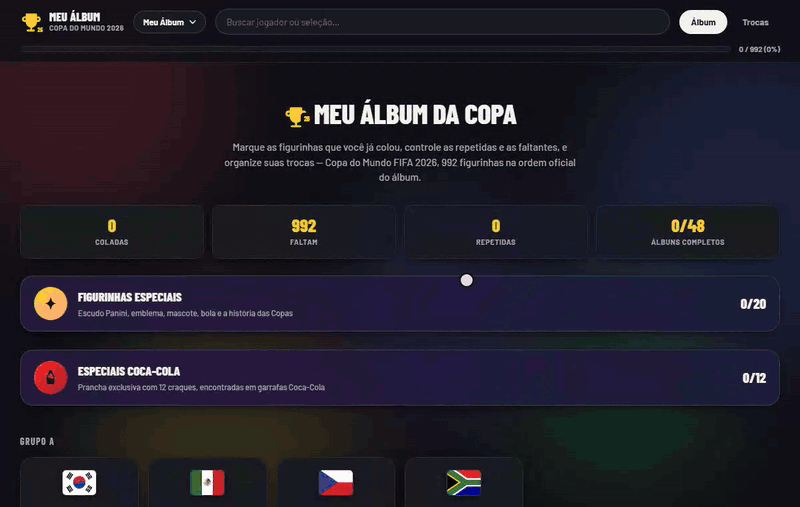
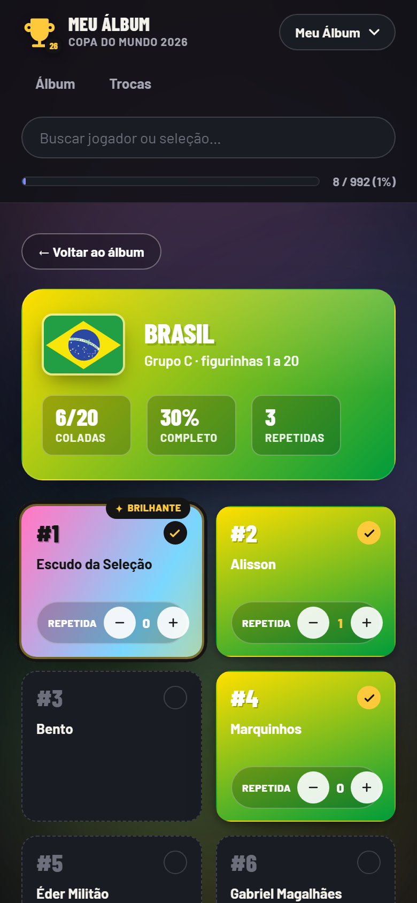
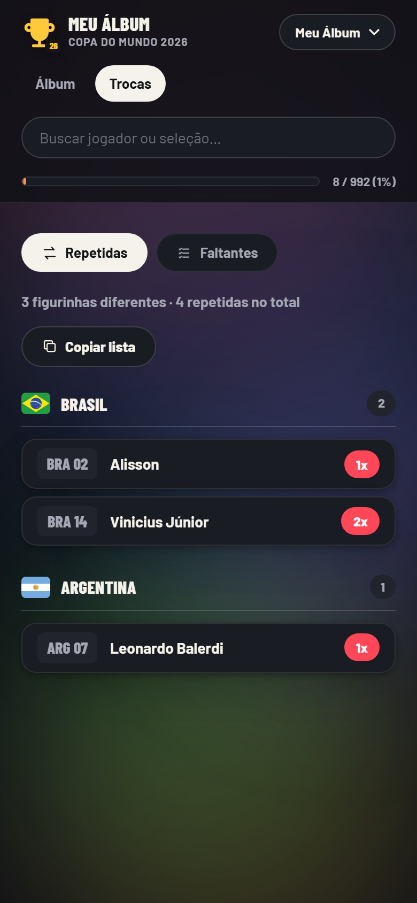
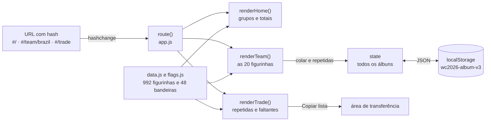

<p align="center">
  <picture>
    <source media="(max-width: 767px)" srcset="https://raw.githubusercontent.com/IsaacGomes260653/Album-da-copa/main/.github/banner-mobile.svg">
    
  </picture>
</p>

<p align="center">
  <b>Álbum digital das figurinhas da Copa do Mundo 2026: marque o que já colou, conte as repetidas e copie a lista do que falta antes de trocar.</b><br>
  Para quem coleciona o álbum e não quer levar o livro para cada troca, e para quem estuda JavaScript sem framework.<br>
  <a href="https://isaacgomes260653.github.io/Album-da-copa/"><b>Abrir o álbum</b></a> · sem cadastro: o progresso fica salvo no próprio navegador
</p>

<p align="center">
  <a href="https://github.com/IsaacGomes260653/Album-da-copa/actions/workflows/pages/pages-build-deployment"></a>
  <a href="LICENSE"></a>
  <a href="https://github.com/IsaacGomes260653/Album-da-copa/commits/main"></a>
  
</p>

<p align="center">
  <a href="#demonstração">Demonstração</a> ·
  <a href="#como-rodar-em-60-segundos">Como rodar</a> ·
  <a href="#o-que-ele-faz">O que ele faz</a> ·
  <a href="#como-foi-feito">Como foi feito</a> ·
  <a href="#testes-e-qualidade">Testes e qualidade</a> ·
  <a href="#próximos-passos">Próximos passos</a> ·
  <a href="#english-summary">English</a>
</p>

## Demonstração

<p align="center">
  
</p>

Gravado com o Playwright, com o app rodando localmente (`python -m http.server`). Na gravação, o fundo animado ficou parado para o GIF caber em menos de 5 MB; o resto está como no app. O app tem só o tema escuro.

No celular, a busca ganha uma linha própria e as figurinhas ficam em duas colunas:

<table>
  <tr>
    <td width="50%" valign="top"></td>
    <td width="50%" valign="top"></td>
  </tr>
</table>

## Como rodar em 60 segundos

Precisa do Git e de um servidor de arquivos estáticos. Aqui, o do Python 3.

```bash
git clone https://github.com/IsaacGomes260653/Album-da-copa.git
cd Album-da-copa
python -m http.server 8000
```

Abra <http://localhost:8000>. Não há dependências nem build: num clone limpo, do `git clone` até o app no ar, levou cerca de 3 segundos (Windows 11 e Python 3.12).

- No macOS e no Linux, o comando pode ser `python3`.
- Também abre sem servidor, com dois cliques no `index.html`: os dados vêm de arquivos `.js` carregados por `<script>`, e não por `fetch`, então nada é bloqueado no `file://`.
- Sem internet, o app aberto localmente funciona igual. Só as fontes, que vêm do Google Fonts, dão lugar à fonte do sistema.
- Cada endereço guarda o seu próprio progresso: o que você marca em `localhost:8000` não aparece no `file://` nem no site publicado.

## O que ele faz

- **As 992 figurinhas na numeração do álbum.** São 48 seleções em 12 grupos (A a L), com 20 figurinhas cada: a 1 é o escudo (brilhante), a 13 é a foto oficial da seleção e as outras 18 são jogadores. Depois vêm as 20 especiais, da 00 (selo Panini) à FWC19 (emblema, mascote, bola, sedes e a história das Copas), e as 12 da Coca-Cola, de CC1 a CC12.
- **Marcar com um toque.** Um toque cola a figurinha, outro descola. A colada ganha um contador de repetidas (`− N +`), e descolar zera as repetidas dela.
- **Progresso em três lugares:** a barra do topo (X / 992), o cartão de cada seleção (X/20) e os totais da tela inicial: coladas, faltam, repetidas e seleções completas.
- **Trocas.** Duas listas, Repetidas e Faltantes, juntam todas as seleções e especiais na ordem do álbum, com o código de cada figurinha (BRA 14). O botão **Copiar lista** copia um texto curto, por seleção, pronto para colar numa conversa:

  ```
  🔁 Minhas repetidas — Álbum Copa 2026 (Meu Álbum)

  BRASIL (2)
  2, 14×2
  ```

- **Vários álbuns.** Um por pessoa, com nome próprio e progresso separado. Dá para criar, renomear, excluir (com confirmação) e trocar de álbum pelo seletor do topo.
- **Busca** por jogador, seleção ou número, sem diferença de acentos: "vini", "japão", "CC1" ou "BRA 3".
- **Prévia em miniatura.** No computador, com o mouse sobre o cartão de uma seleção, aparece a grade das 20 figurinhas com as que já foram coladas.
- **Teclado.** Cartões, figurinhas e itens dos menus respondem a Tab, Enter e Espaço, e o leitor de tela ouve o nome e se a figurinha está colada ou faltando.
- **Instalável.** Tem manifesto e ícones próprios para adicionar à tela inicial do celular e abrir como app, sem a barra do navegador. Não tem service worker, então o site publicado precisa de internet para abrir.

> O app usa as bandeiras reais das seleções, do [flag-icons](https://github.com/lipis/flag-icons), e os códigos da FIFA (BRA, ARG, GER), mas não reproduz brasões de federações nem fotos de jogadores, que têm direitos de imagem. O visual é próprio, não uma cópia do álbum da Panini.

## Como foi feito

| Escolha | Por quê |
|---|---|
| HTML, CSS e JavaScript, sem framework e sem build | São três telas e um estado pequeno. O GitHub Pages publica a `main` como ela está, e o app roda em qualquer servidor estático ou até sem servidor. |
| Rotas no hash da URL (`#/`, `#/team/brazil`, `#/trade`, `#/trade/faltam`) | O GitHub Pages só entrega arquivos. Com o hash, cada tela tem endereço próprio e o botão voltar funciona, sem nenhuma regra no servidor. |
| `localStorage` | Sem conta e sem backend: todos os álbuns ficam num JSON só, na chave `wc2026-album-v3`. |
| Dados em `data.js` e bandeiras em `flags.js` | Carregados por `<script>` como constantes, funcionam até no `file://`. As 48 bandeiras do flag-icons vão embutidas em SVG, sem pedir nada a outro servidor. |
| Variáveis CSS por seleção (`--c1` e `--c2`) | Cada seleção tem duas cores no `data.js`, e o cartão, o cabeçalho e as figurinhas coladas usam essas cores sem uma regra de CSS para cada time. |
| Manifesto web | Nome, cores e ícones, incluindo o ícone adaptável do Android, para instalar o app na tela inicial. |



Cada toque muda o `state`, grava o JSON inteiro no `localStorage` e redesenha só o que mudou: na página da seleção, a grade, o cabeçalho e a barra do topo.

### Decisões técnicas e o que eu aprendi

- **Só o que foi marcado vai para o estado.** Uma figurinha sem marca e sem repetida sai do objeto, então um álbum novo é `{}` e o JSON cresce com o que foi colado, não com as 992.
- **Repetida depende de colada.** O contador só aparece em figurinha colada, e descolar zera as repetidas. Um bug antigo fazia o clique no contador descolar a figurinha. Agora o clique no contador para nele, com o `stopPropagation()`.
- **A ordem do álbum, não a do alfabeto.** As listas de troca percorrem as seleções e as figurinhas na ordem dos dados. Ordenar por texto punha a 10 antes da 2.
- **Aspas no `onclick`.** Os números das especiais são texto ("00", "FWC1", "CC1") e quebravam o `onclick` montado no HTML. A função `jsNo()` passa esses números entre aspas escapadas.
- **Mudar o formato sem perder o progresso.** O estado passou de um álbum só (chaves `wc2026-album-v1` e `-v2`) para vários álbuns (`-v3`). Na primeira abertura da versão nova, as figurinhas da antiga viram o "Meu Álbum".
- **Teclado com um listener só.** Cartões e figurinhas são `div` com `role="button"` e `tabindex="0"`, e um único listener no `document` transforma Enter e Espaço em clique.

<details>
<summary>Estrutura de pastas</summary>

```
.
├── index.html          # a página: topo com busca, seletor de álbuns e barra de progresso
├── style.css           # o visual: tema escuro, cores por seleção e layout do celular
├── app.js              # estado, rotas, telas, busca, prévia e listas de troca
├── data.js             # as 48 seleções, as 20 especiais e as 12 da Coca-Cola
├── flags.js            # as 48 bandeiras do flag-icons, em SVG embutido
├── manifest.json       # nome, cores e ícones para instalar na tela inicial
├── favicon.png, apple-touch-icon.png e icon-*.png
├── LICENSE
└── .github/
    ├── banner.svg, banner-mobile.svg e social-preview.png
    └── capturas/       # GIF e capturas deste README
```

</details>

## Testes e qualidade

O projeto não tem testes automatizados nem lint. A única automação é o `pages-build-deployment`, o workflow que o próprio GitHub Pages roda a cada push na `main` para publicar o site. É o status dele que aparece no badge.

Para este README, conferi o app no Chromium, com o Playwright, a partir de um clone limpo:

- os dados somam 992 figurinhas (48 × 20 + 20 + 12), sem número repetido dentro de uma seleção, e as 48 seleções têm bandeira;
- colar, contar repetidas, as duas listas de troca e o texto copiado;
- a busca, os vários álbuns e a prévia em miniatura;
- o app aberto pelo `file://` e sem internet;
- nenhum erro no console.

Nessa revisão apareceram os bugs que abrem a lista de próximos passos.
